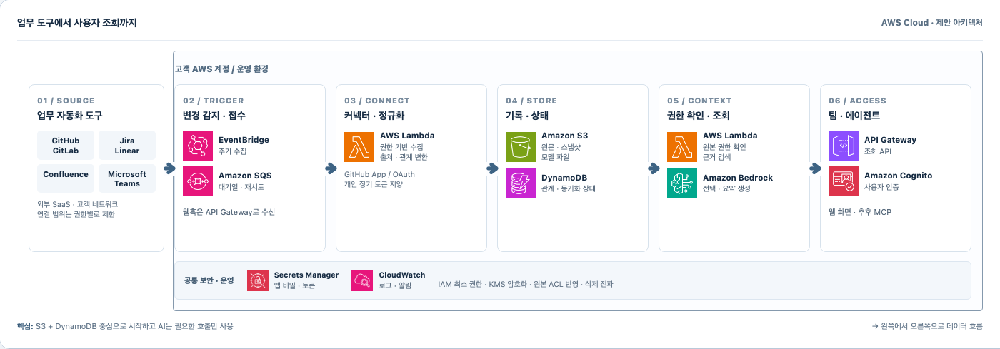

# Team Context

팀의 문서, 코드, 대화, 업무 티켓을 공통 형식으로 연결하기 위한 오픈소스 프로젝트입니다.

- [아키텍처 문서와 AWS 설계 옵션](docs/architecture.md)
- [커넥터 개발 안내](docs/connectors.md) · [로컬 개발 및 테스트](docs/development.md)
- [공유용 아키텍처 페이지](https://youngjinjung.github.io/team-context/)
- [개발 이슈와 남은 작업](https://github.com/YoungJinJung/team-context/issues)

## 아키텍처

아래는 **AWS 배포를 위한 제안**입니다. 현재 저장소는 로컬 프로토타입이며 AWS 배포와 COA 연동은 아직 구현하지 않았습니다.



[COA 확장형 다이어그램과 비용 최적화](docs/architecture.md#2-coa-확장형-온톨로지와-그래프-탐색)를 함께 확인하세요.

## 현재 상태

로컬 개발용 프로토타입입니다. GitHub 공개 저장소 PR 또는 GitLab.com 공개 프로젝트 MR을 수집합니다. 두 서비스 모두 최대 100페이지를 조회합니다. 수집한 결과는 LocalStack S3에 저장하고 DynamoDB에 건수를 기록합니다. 어느 서비스든 100페이지가 모두 가득 차면 누락 가능성 때문에 수집 전체를 실패 처리합니다. 저장된 공개 PR/MR은 제목·본문의 단순 문자열로 검색할 수 있습니다. GitLab.com 비공개 MR은 인증한 사용자가 로컬에서 수집하고 원본 권한 확인 후 검색할 수 있습니다. 다른 비공개 자료 수집과 삭제·권한 변경의 자동 동기화는 제공하지 않습니다. Linear 인증은 로컬 시험용입니다. 실제 AWS 리소스를 만들지 않으며 인터넷에 공개해 운영하지 마세요.

## 로컬 실행

Docker, Python 3.11 이상, [uv](https://docs.astral.sh/uv/)가 필요합니다.

```sh
uv sync --no-install-project
docker compose up -d --wait
uv run --no-sync python init_local.py
uv run --no-sync python app.py
```

http://127.0.0.1:8765 에서 `owner/repository`를 입력합니다. 서비스 API의 인증 없는 요청 제한이 적용됩니다. GitLab은 중첩 그룹을 포함해 `group/project` 형식으로 입력합니다. 에뮬레이터 포트는 `127.0.0.1:4568`이며 별도 AWS 계정은 필요하지 않습니다. LocalStack은 S3·DynamoDB·Secrets Manager를 사용합니다. LocalStack 데이터는 개발용이며 실제 비밀을 안전하게 보관하는 저장소로 취급하지 마세요. 종료할 때 `docker compose down`을 실행합니다. 데이터는 Docker 볼륨에 남습니다. `down -v`는 해당 데이터를 삭제합니다.

## 테스트

```sh
uv run --no-sync pytest -q
TEAM_CONTEXT_INTEGRATION=1 uv run --no-sync pytest -q tests/test_localstack.py
uv run --no-sync mutmut run --max-children 4
uv run --no-sync mutmut export-cicd-stats
uv run --no-sync python scripts/check_mutation.py mutants/mutmut-cicd-stats.json
uv run --no-sync mutmut results
```

통합 테스트는 실행 중인 로컬 에뮬레이터가 필요하며 테스트 데이터를 생성하고 삭제합니다. 뮤테이션 테스트를 새로 측정하려면 이전 `mutants/` 결과를 먼저 삭제해야 합니다. 뮤테이션 테스트는 서버, 저장소, 인증과 커넥터를 포함한 백엔드 Python 코드에 적용합니다. UI와 외부 AWS/서비스 구현은 대상이 아닙니다. CI는 탐지한 변이 수를 전체 변이 수로 나눈 점수가 90% 이상인지 검사합니다. 도구 오류와 의심 사례는 탐지로 계산하지 않습니다. 이 수치는 모든 가능한 동작이 검증되었다는 뜻은 아닙니다.

## 커넥터 만들기

`connectors/`에 Python 모듈을 추가하면 실행기가 자동으로 찾습니다. 모듈은 `MANIFEST`, `connection_id(config)`와 `collect(config)`를 제공합니다. `connection_id`는 커넥터별 접두사와 안정적인 소스 식별자로 구성하며 비밀 정보를 포함하지 않습니다. `MANIFEST`의 `fields`는 연결 화면의 입력 항목으로 표시됩니다. `collect`는 `id`, `type`, `title`, `url`, `updated_at`, `body`를 가진 레코드 목록을 반환합니다. 예제는 [GitHub 커넥터](connectors/github.py)를 확인하세요. 서버 재시작 후 새 커넥터가 표시됩니다. 레코드 ID는 서비스와 소스 범위를 포함해 다른 커넥터와 충돌하지 않아야 합니다. 신뢰할 수 있는 커넥터 코드만 설치하세요.

## 인증 개발 현황

Linear OAuth 2.0 PKCE 연결을 로컬에서 시험할 수 있습니다. Linear에서 앱을 생성하고 리디렉션 URI를 `http://127.0.0.1:8765/oauth/linear/callback`으로 등록한 뒤 공개 클라이언트 ID를 `LINEAR_CLIENT_ID`로 설정해 실행하세요. 클라이언트 비밀번호나 개인 API 키를 입력하지 않습니다. 인증은 브라우저 세션에 연결하고 토큰은 로컬 Secrets Manager에 저장합니다. 인증 후 선택한 팀의 이슈를 최대 30개 미리 볼 수 있습니다. 이 이슈는 S3나 공용 검색에 저장하지 않습니다. 연결 참조는 브라우저 세션 해시와 함께 로컬 DynamoDB에 보관하므로 서버 재시작 후에도 복구됩니다. 현재 브라우저 세션에서 연결 해제 시 저장된 비밀을 삭제합니다. 만료되거나 브라우저 쿠키가 삭제된 연결의 비밀 정리, 이슈 동기화·저장과 다중 프로세스 갱신 제어는 아직 지원하지 않습니다. 로컬 단일 프로세스에서는 Linear가 HTTP 401을 반환하면 PKCE 갱신 토큰을 사용해 한 번 갱신하고 재시도합니다. 이전 버전 연결은 클라이언트 ID가 없어 재연결이 필요할 수 있습니다. 실제 조직 토큰은 LocalStack에 저장하지 마세요.

Microsoft Teams는 로컬에서 Entra 공개 클라이언트의 OAuth PKCE로 연결하고 팀 및 채널 목록의 첫 페이지만 브라우저에서 미리 볼 수 있습니다. Microsoft Entra 앱 등록에서 모바일 및 데스크톱 공개 클라이언트를 설정하고, 조직 계정용 위임 권한 `Team.ReadBasic.All`, `Channel.ReadBasic.All`과 `offline_access`에 동의해야 합니다. 리디렉션 URI `http://127.0.0.1:8765/oauth/teams/callback`은 앱 매니페스트에서 등록하고 공개 클라이언트 ID를 `TEAMS_CLIENT_ID`로 설정하세요. 조직 정책에 따라 관리자 동의가 필요할 수 있습니다. 공유 채널의 호스트 팀은 이 목록에 포함되지 않을 수 있습니다. 메시지 수집, 페이지 전체 조회, 원본 권한 동기화는 지원하지 않습니다. Linear와 마찬가지로 실제 조직 토큰은 로컬 에뮬레이터에 저장하지 마세요.

GitLab.com 비공개 프로젝트는 공개 OAuth 앱의 PKCE 연결 후 현재 사용자의 접근 권한으로 MR 최대 30개를 미리 볼 수 있습니다. GitLab OAuth 앱에서 `Confidential` 설정을 끄고 `read_api` 권한과 리디렉션 URI `http://127.0.0.1:8765/oauth/gitlab/callback`을 등록한 뒤 앱 ID를 `GITLAB_CLIENT_ID`로 설정하세요. 미리보기는 저장·공유되지 않습니다. 연결 해제는 로컬 토큰을 삭제하며 GitLab의 앱 승인 철회는 별도로 해야 합니다. 로컬 개발에서 비공개 MR을 프로젝트별 단일 스냅샷으로 수집하고, 검색 시 요청자의 토큰으로 프로젝트 및 원본 MR을 다시 확인할 수 있습니다. 100개씩 최대 10페이지와 마지막 빈 확인 페이지를 조회하며, 11번째 페이지에 자료가 있거나 스냅샷이 2 MiB를 넘으면 저장하지 않습니다. 원본 접근이 거부되거나 MR이 삭제·변경된 경우 해당 검색 결과를 반환하지 않습니다. 검색 시 원본 API 요청이 발생하고, 확인 이후의 권한 변경까지 즉시 보장하지는 못합니다. 페이지를 수집하는 동안 원본이 바뀌면 일부 자료가 누락될 수 있으므로 다시 수집해야 합니다. 여러 프로세스의 동시 수집은 마지막 쓰기가 이기며, 만료된 스냅샷 자동 삭제와 운영용 사용자 격리는 아직 없습니다. 현재 자체 호스팅 GitLab, GitHub 비공개 자료의 저장과 운영용 공유 수집은 지원하지 않습니다. 실제 조직 토큰은 LocalStack에 저장하지 마세요.

GitHub.com 비공개 저장소는 GitHub App을 설치하고 해당 사용자가 앱을 승인한 뒤 PR 최대 30개를 미리 볼 수 있습니다. 앱에 저장소 Pull requests 읽기 권한을 설정하고 콜백 URI `http://127.0.0.1:8765/oauth/github/callback`을 등록하세요. `GITHUB_CLIENT_ID`에는 앱 클라이언트 ID를, `GITHUB_APP_SECRET_ID`에는 로컬 Secrets Manager에 JSON `{"client_secret":"..."}`으로 등록한 앱 비밀의 참조 ID를 설정합니다. 개인 토큰은 입력하지 않습니다. 미리보기는 저장·공유되지 않으며 연결 해제는 로컬 토큰만 삭제합니다. 실제 비밀과 조직 토큰을 LocalStack에 저장하지 마세요. 이 로컬 데모는 GitHub Enterprise를 지원하지 않습니다.
로컬 모의 테스트에서는 `uv run --no-sync python -c 'from auth.vault import create; print(create({"client_secret":"fake-local-secret"}))'`로 가짜 비밀의 참조 ID를 만들 수 있습니다. 이 예제 값으로 실제 GitHub 인증을 할 수는 없습니다.

권한을 잃은 뒤에도 로컬 운영자는 에뮬레이터의 GitLab 프로젝트 ID를 나열하고 특정 스냅샷을 지울 수 있습니다. 수집 중인 서버를 먼저 종료하세요. 다시 수집하면 스냅샷이 생성됩니다. 이 명령은 로컬 에뮬레이터에 접근할 수 있는 운영자용이며 운영 환경의 다중 사용자 삭제 권한을 제공하지 않습니다.

```sh
uv run --no-sync python -m scripts.private_snapshots list
uv run --no-sync python -m scripts.private_snapshots remove 123 --confirm
```

## 다음 단계

- GitHub 비공개 PR 수집·검색, GitHub Enterprise 및 자체 호스팅 GitLab 지원
- Jira·Confluence 연결, Linear 이슈와 Teams 메시지 수집, 서비스 독립적인 저장 계약
- 원본 권한·삭제 동기화, 안전한 인증 정보 저장
- 검색 품질 개선, AWS 배포 및 COA 연동

커넥터 계약과 기능은 초기 단계로 변경될 수 있습니다.

검색은 공개로 표시된 GitHub·GitLab 자료를 반환하기 전에 각 원본이 익명으로 접근 가능하고 내용이 수집 시점과 같은지 다시 확인합니다. 원본 검증이 실패하면 결과를 반환하지 않습니다. 일치하는 후보마다 API를 호출하므로 결과가 최대 30개여도 검증 요청은 더 많을 수 있습니다. API 속도 제한과 지연이 발생할 수 있습니다. 검증 이후 원본이 변경되는 순간까지 보호하지는 못합니다. 이전 버전에서 수집한 자료는 다시 수집해야 검색됩니다. 삭제·권한 변경은 저장소에서 자동 삭제되지 않습니다. 화면의 명시적 정리는 404/410 원본만 확인 후 로컬 기록을 삭제합니다. API 호출량이 많을 수 있으며 검증 이후 원본이 바뀌는 경우까지 보장하지 않습니다. 정리 중 삭제가 실패하면 이미 삭제된 일부 기록은 복원되지 않으며 다시 실행해 나머지를 처리할 수 있습니다. 수집 건수는 마지막 수집 시점 기준으로 남습니다. 수집된 공개 저장소 목록에서 마지막 수집 건수를 확인하고 로컬 자료를 명시적으로 삭제할 수 있습니다. 공개 여부가 없거나 공개가 아닌 레코드는 이 삭제 기능이 보존합니다. 실시간 권한 모델은 아직 없으므로 민감한 자료를 수집하거나 공유 환경에서 사용하지 마세요.
