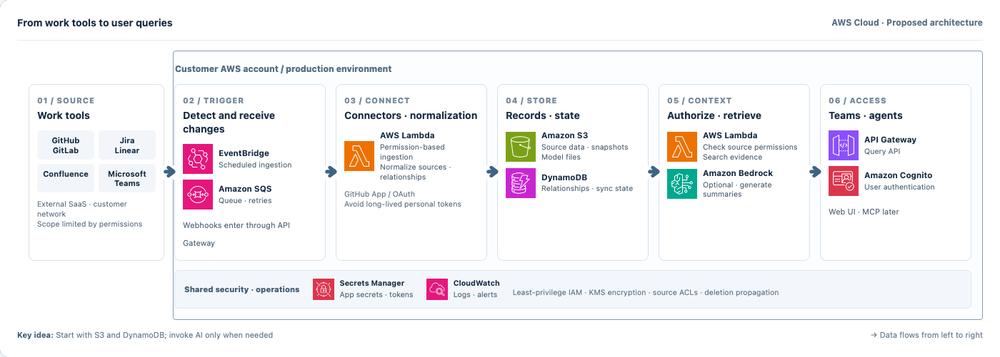
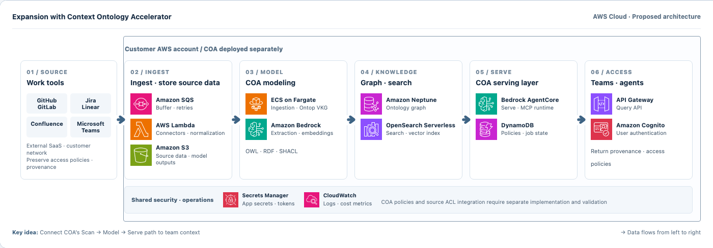
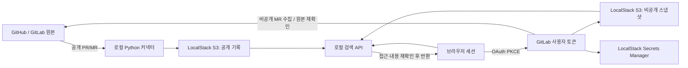

# 팀 업무 맥락 공유 아키텍처

> **상태: 제안 설계와 로컬 구현을 함께 설명합니다.** 아래 AWS 리소스, COA 연동, 운영용 권한 체계는 이 저장소에서 배포하거나 구현하지 않았습니다. 현재 실행 가능한 범위는 [구현 현황](#현재-구현-현황)을 확인하세요. 공유용 화면은 [아키텍처 페이지](index.html)에서 볼 수 있습니다.

팀이 사용하는 문서, 소스코드, 티켓, 대화에서 맥락을 수집하고 `사람–팀–서비스–문서–변경–이슈–결정`의 관계와 출처를 연결합니다. 원본 시스템의 접근 권한을 유지한 채 사용자와 에이전트가 근거를 찾는 것이 목표입니다. **커넥터 접근 권한과 조회자의 원본 접근 권한은 서로 다른 검증입니다.**

## 1. 저비용 MVP: 수집과 근거 검색부터

위 화살표는 원본에서 수집된 데이터가 조회 결과로 제공되는 방향입니다. 실제 사용자 요청은 오른쪽 API에서 시작해 저장소와 원본 권한 검증으로 이어집니다. 원본 업무 도구는 AWS 계정 밖에 있습니다. 그림의 Lambda, SQS, EventBridge, Cognito 및 Bedrock 경로는 **향후 구현할 제안**입니다.

1. GitHub/GitLab, Jira/Linear, Confluence, Teams를 공급자별 커넥터로 연결합니다. 웹훅이 가능한 원본은 서명 검증을 거쳐 접수하고, 나머지는 주기적으로 변경분을 확인합니다.
2. EventBridge Scheduler와 SQS로 작업을 예약·완충하고, Lambda가 원본의 ID, 수정 시각, 출처, 접근 범위를 공통 형식으로 변환합니다. 재시도와 실패 큐의 적용 여부는 구현 시 결정합니다.
3. S3에는 원문과 모델 파일, DynamoDB에는 작업·동기화 상태 및 간단한 관계 인덱스를 저장합니다. 이것은 **공유 온톨로지를 담기 위한 초기 저장 방식 제안**이며, COA의 RDF/SPARQL 그래프를 구현했다는 뜻은 아닙니다.
4. API Gateway와 Lambda가 요청자를 인증하고 원본 권한을 확인해 근거를 반환합니다. Bedrock 요약은 선택 사항입니다. 사용자 계정과 원본 계정 연결, 비공개 자료에 대한 조회 시 권한 검증 및 변경·삭제 전파가 구현되기 전에는 운영 환경에 노출하지 않습니다.

초기 모델은 `Person`, `Team`, `Service`, `Repository`, `Document`, `Issue`, `Change`, `Conversation`, `Decision`을 후보로 둡니다. 관계 예시는 `AUTHORED_BY`, `IMPLEMENTS`, `REFERENCES`, `DECIDED_IN`입니다. 각 사실에는 원본 서비스·ID·URL·수집 시각·버전·접근 범위와 추출 방식을 기록하고, 추론 결과와 원문을 구분합니다. 이는 제안 모델이며 현재 코드에 온톨로지 엔진이 있다는 의미는 아닙니다.

## 2. COA 확장형: 온톨로지와 그래프 탐색

필요할 때 AWS의 [Context Ontology Accelerator](https://aws.github.io/context-ontology-accelerator/)를 별도로 배포해 **Scan → Model → Serve** 경로에 연결합니다. COA의 배포 구성은 릴리스에 따라 달라질 수 있으므로 실제 스택은 선택한 버전의 [배포 문서](https://github.com/aws/context-ontology-accelerator/blob/main/external-docs/content/deploying.md)를 기준으로 합니다.

- **Scan**: 커넥터가 원문과 메타데이터를 S3에 전달합니다. COA의 문서 수집·enrichment 및 Ontop VKG는 ECS on Fargate를 사용하며 Bedrock은 추출과 임베딩에 사용됩니다.
- **Model**: OWL/RDF·SHACL 모델과 관계를 구성하고 Neptune에 지식 그래프를 저장합니다. COA는 AI 보조 온톨로지 제안에 사람의 검토 기능을 제공합니다. 이 기능은 초기 MVP의 필수 승인 절차가 아닙니다.
- **Serve**: OpenSearch Serverless로 검색하고 COA Serve/MCP 런타임으로 결과와 근거를 제공합니다. COA의 정책·세션 등은 DynamoDB를 사용합니다.

COA [v0.3.11의 MCP 서버](https://github.com/aws/context-ontology-accelerator/blob/v0.3.11/packages/mcp-server/README.md)는 AgentCore Runtime에서 `query`, `rag_retrieval`, `graph_traversal` 등을 제공하고 요청자 JWT 및 Cedar 권한을 처리합니다. COA는 자체 Cognito 또는 [외부 OIDC와 연동](https://github.com/aws/context-ontology-accelerator/blob/v0.3.11/external-docs/content/authentication-setup.md)할 수 있습니다. Entra는 가능한 IdP 후보이며, 별도의 Entra 검증기를 중복 구현하기 전에 선택한 COA 릴리스의 실제 연동을 검증합니다. 현재 이 저장소의 로컬 stdio MCP는 공개 검색 데모이며 COA MCP와 별개입니다.

COA의 권한 기능을 설치하는 것만으로 GitHub, GitLab, Jira, Confluence 또는 Teams의 원본 ACL이 자동으로 보존된다고 가정하지 않습니다. 공급자별 사용자 식별자 매핑, 테넌트 경계, 문서·스레드 단위 권한, 삭제·권한 회수 전파와 접근 실패 시 차단을 별도로 구현하고 검증해야 합니다. 이메일 주소가 같다는 이유만으로 서로 다른 서비스 계정을 자동 연결하지 않습니다.

## 현재 구현 현황

| 영역 | 현재 상태 | 범위와 한계 |
| --- | --- | --- |
| 로컬 실행 | 구현 | 단일 프로세스 HTTP 서버, LocalStack S3·DynamoDB·Secrets Manager. AWS 배포는 없음. |
| 공개 GitHub/GitLab | 구현 | GitHub.com PR, GitLab.com MR 수집 및 익명 원본 재검증 검색. 소스 파일 자체는 수집하지 않음. |
| GitLab.com 비공개 MR | 로컬 실험 | OAuth PKCE, 프로젝트 ID별 스냅샷, 조회자의 토큰으로 프로젝트·원본 재검증. 실제 조직 데이터를 LocalStack에 넣지 않음. |
| GitHub.com 비공개 PR | 로컬 실험 | GitHub App 사용자 OAuth, 저장소 ID별 스냅샷, 조회자의 토큰으로 저장소·원본 재검증. 실제 조직 데이터를 LocalStack에 넣지 않음. |
| MCP | 로컬 구현 | stdio로 공개 PR/MR 검색과 출처 반환. 비공개 자료와 다중 사용자 인증은 미구현. |
| Linear · Microsoft Teams | 미리보기 | Linear 팀·이슈, Teams 팀·채널. 이슈 저장 및 Teams 메시지 수집은 미구현. |
| Jira · Confluence | 미리보기 | Atlassian OAuth로 사이트와 부여된 제품 범위를 확인. 문서·티켓 수집과 개별 항목 권한 검증은 미구현. |
| 자체 호스팅 | 미구현 | GitHub Enterprise·자체 호스팅 GitLab 지원 예정. |
| 인증·접근 | 로컬 실험 | 공급자별 세션과 로컬 토큰 저장. 운영용 사용자/테넌트 격리, 중앙 감사, 자동 권한·삭제 전파는 미구현. |
| 온톨로지 · AWS 배포 | 미구현 | COA 연동, Neptune, OpenSearch, AWS IaC 및 배포는 미구현. |

공개 커넥터는 `connectors/`의 `MANIFEST`, `connection_id`, `collect` 계약으로 자동 탐색합니다. OAuth 연결 수명주기는 명시적 공급자 레지스트리를 사용합니다. 공급자별 미리보기와 비공개 검색은 별도 구현합니다.

공개 검색은 결과를 반환하기 전 익명으로 원본을 재확인합니다. 비공개 GitHub·GitLab 검색은 해당 사용자의 토큰으로 저장소 또는 프로젝트와 각 PR·MR을 재검증합니다. 원본 권한이 회수되더라도 스냅샷은 자동 삭제되지 않으며, 검증 이후 원본이 바뀌는 시점까지 보호할 수 없습니다. GitLab 수집은 최대 10개 데이터 페이지와 빈 확인 페이지를 조회하고 2 MiB를 넘는 스냅샷을 거절합니다. 수집 중 원본이 바뀌면 누락될 수 있습니다. 자세한 로컬 사용법은 [README](../README.md)를 확인하세요.

이 저장소는 COA v0.3.11의 `coa-common` 인증기를 사용하는 선택적 신원 검증 어댑터를 제공합니다. 이 어댑터는 인증을 끈 설정을 거부하고 지정된 발급자와 대상, Entra 또는 Cognito의 사용자 위임 범위, 토큰 만료와 사용자 식별자를 확인합니다. Python 3.12 이상과 `coa` 추가 의존성이 필요합니다. COA v0.3.11의 인증기는 키 서버 장애 중 만료된 JWKS 캐시를 최대 1시간 더 사용할 수 있으며, 이 어댑터도 그 동작을 상속합니다. 키 폐기 전파 지연과 캐시 정책은 운영 전에 검토해야 합니다. 이 어댑터는 아직 공급자 계정 연결이나 COA MCP 서버에 연결되지 않았으므로 비공개 조회 기능이 아닙니다. 실제 COA 및 IdP 연동 검증은 [#72](https://github.com/YoungJinJung/team-context/issues/72)에 남아 있습니다.

계정 연결을 위한 내부 `LinkAttempts`는 COA 검증 신원과 OAuth PKCE 상태를 KMS로 암호화하고, 해시된 상태·브라우저 nonce와 만료 시각을 DynamoDB에 저장합니다. 조건부 삭제로 유효한 콜백만 한 번 소비하며, 잘못된 nonce나 다른 공급자의 콜백은 정상 요청을 소모하지 않습니다. 실제 배포에서는 전용 테이블의 `expires_at` TTL, 최소 권한 IAM과 KMS 키 정책을 설정해야 합니다. 소비 후 KMS 복호화가 실패하면 안전하게 재시도를 거부하므로 사용자는 새 연결을 시작해야 합니다. 향후 HTTP 핸들러는 nonce를 Secure·HttpOnly·SameSite 쿠키로만 전달하고, 완료 시 COA 세션의 사용자·권한을 다시 확인해야 합니다. 아직 HTTP 엔드포인트, 보안 쿠키 설정, 공급자 토큰 교환·저장 또는 COA MCP 연동이 없어 실제 계정 연결 기능은 아닙니다.

## 비공개 자료와 COA의 보안 경계

다음은 설계 조건이며 현재 구현된 기능이 아닙니다. 진행 현황은 [#68](https://github.com/YoungJinJung/team-context/issues/68)을 확인하세요.

1. **인증과 계정 연결:** COA가 검증한 사용자와 테넌트 식별자를 사용합니다. GitHub App 또는 GitLab OAuth 연결을 그 사용자에게 명시적으로 묶고, 수집자의 토큰과 조회자의 토큰을 혼용하지 않습니다. 고정된 신뢰 호스트만 허용합니다.
2. **원본 권한:** 반환할 각 원문과 버전에 대해 요청자의 접근 권한을 원본에서 확인합니다. 권한 회수·삭제·오류·검증 불가 시 차단하고, 로그·목록·건수에도 비공개 정보가 새지 않게 합니다.
3. **검색과 파생 데이터:** COA 네임스페이스·Cedar 권한과 원본 ACL은 서로 다른 경계입니다. 원문뿐 아니라 RAG 청크, 그래프 관계, 자연어 답변에 영향을 준 모든 출처의 권한을 검증할 수 없으면 비공개 결과를 반환하지 않습니다. 권한 확인 전에 생성된 답변을 후처리로 필터링하는 것만으로는 충분하지 않습니다.
4. **우회 방지와 정리:** 직접 COA MCP·API·데이터 저장소 경로가 위 검증을 우회하지 못하도록 배포와 IAM을 설계합니다. 변경·삭제·권한 회수 시 원문, 인덱스와 파생 그래프를 동기화하고, 동기화 지연 중에도 안전하게 차단합니다.
5. **검증:** 두 테넌트와 여러 사용자, 권한 회수·원본 변경·서비스 장애·동시 요청을 포함한 테스트를 실제 COA의 고정 릴리스와 공급자 샌드박스에서 수행합니다. LocalStack과 모의 테스트만으로 운영 보안을 보장하지 않습니다.

## 비용 최적화와 산정

**금액은 확정 견적이 아닙니다.** 리전, 월 사용 시간, 문서·메시지 크기, 수집 빈도, 검색량, 데이터 보존 기간, 고가용성 및 모델 입출력 토큰 수가 결정되지 않았습니다. 이전 예시 금액을 현재 구성의 견적으로 사용하지 말고 [AWS 요금 계산기](https://calculator.aws/)에 아래 항목을 입력하세요.

| 항목 | MVP에서 줄이는 방법 | 비용 산정 입력 |
| --- | --- | --- |
| 수집·API | 증분 수집, 중복 제거, 배치, Lambda 메모리·실행 시간 측정 | Lambda 호출·실행 시간, API Gateway 요청, SQS 요청, EventBridge 일정 |
| 저장 | 원문과 스냅샷 보존 기간 설정, S3 Lifecycle 적용 검토 | S3 GB·요청, DynamoDB 읽기·쓰기·저장, 백업 |
| 모델 | 선택적으로 사용, 변경된 자료만 재처리, 작은 모델부터 평가 | Bedrock 모델별 입력·출력 토큰, 임베딩량, 재시도 |
| 운영·보안 | 로그 보존 기간과 최소 권한 설정 | CloudWatch 로그·알람, Secrets Manager 비밀 수·호출, KMS, 데이터 전송, NAT·VPC 엔드포인트 |
| 그래프 | 초기 MVP에서 생략하고 그래프 탐색 수요가 생기면 도입 | Neptune 인스턴스 수 × NCU 시간, 스토리지, I/O, 백업 |
| 검색 | 초기에는 적은 규모의 단순 검색을 평가하고 규모에 맞춰 도입 | OpenSearch 수집·검색 OCU 시간, 스토리지, 데이터 전송 |

[Neptune Serverless](https://docs.aws.amazon.com/neptune/latest/userguide/neptune-serverless-capacity-scaling.html)는 각 인스턴스의 최소 용량이 1 NCU여서 사용하지 않을 때 자동으로 0까지 줄어들지 않습니다. 리더를 추가하면 별도 인스턴스 용량도 계산해야 합니다.

[OpenSearch Serverless NextGen](https://docs.aws.amazon.com/opensearch-service/latest/developerguide/serverless-scale-to-zero.html) 컬렉션 그룹은 최소 OCU를 0으로 설정할 수 있습니다. 10분 동안 요청이 없을 때 컴퓨팅이 축소되고, 재개 시 첫 요청에 10–30초 지연이 발생할 수 있습니다. 0 OCU는 저장·기타 비용이 모두 0이라는 뜻이 아닙니다. **Classic 컬렉션 그룹은 0을 지원하지 않습니다.** 또한 2026년 11월 25일 확인한 [COA 배포 문서](https://github.com/aws/context-ontology-accelerator/blob/main/external-docs/content/deploying.md)의 기본 최소값은 2 OCU이며 0으로 낮추면 인덱싱 429 및 재시도 가능성이 커집니다. 실제 COA 버전, 리전, 용량 설정을 확인하세요.

팀 규모, 월 질문 수, 수집량, 데이터 크기, 보존 기간과 가용성 목표가 정해지면 두 안을 같은 조건으로 계산하고 비용 알림을 설정합니다. 프로토타입에서는 유료 서비스를 임의로 생성하지 않습니다.

## 로컬 데이터 흐름

다이어그램의 OAuth 흐름은 현재 GitLab.com 비공개 MR 경로를 예로 든 것입니다. 다른 공급자의 세션 정보는 LocalStack DynamoDB에 해시된 참조로 저장되며, 위 그림에 생략했습니다. 로컬 에뮬레이터는 운영 보안 경계를 제공하지 않으므로 실조직 토큰과 민감한 업무 자료를 저장하지 마세요.

AWS 서비스 아이콘은 [AWS 아키텍처 아이콘](https://aws.amazon.com/architecture/icons/)을 사용했습니다.
